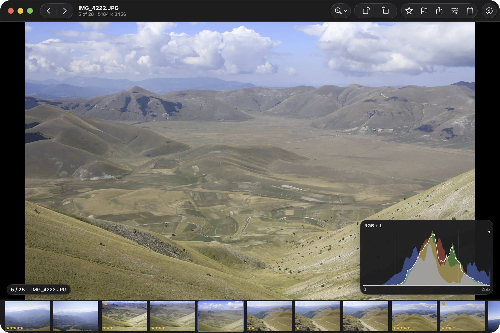
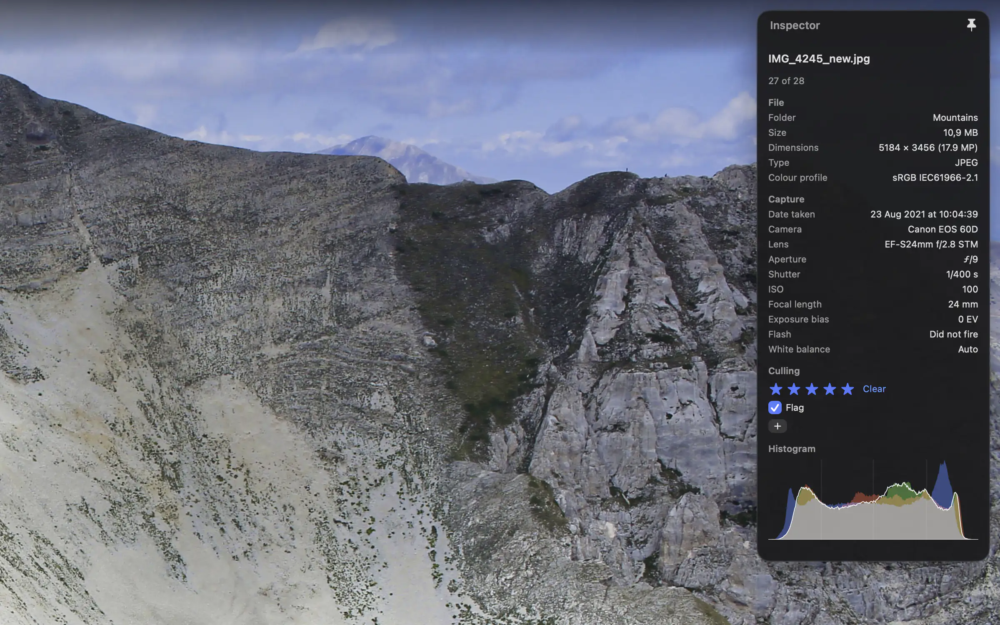
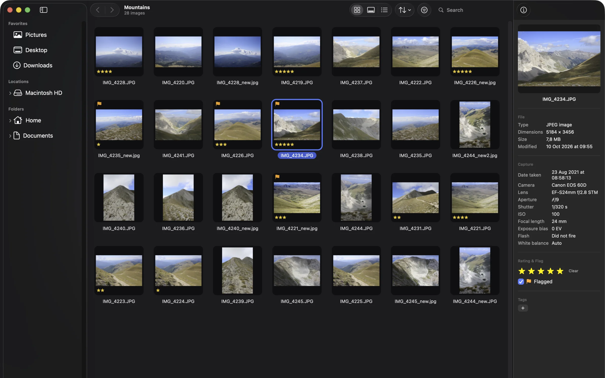

# Shrike

A fast, free, open-source image viewer for Mac. Press **Space** and the next
photo is already on screen.

[**Download for Mac**](https://github.com/voydapps/shrike/releases/latest) ·
macOS 14 or newer · Apple silicon and Intel · MIT license

<p align="center">
  
</p>

<p align="center">
  
  
</p>

## What it does

- **Move through photos instantly.** Space or the arrow keys. Shrike decodes
  the next photos before you ask. Pinch to zoom, drag to pan, hold `Z` for a
  loupe, `A` for 100 %, `B` to fit the window.
- **Browse a whole folder.** Folder list, thumbnail grid, list or filmstrip.
  Names sort naturally, so IMG_2 comes before IMG_10. Thumbnails are saved
  between launches.
- **Cull quickly.** Rate with `1`–`5`, flag with `Q`, add Finder tags. Copy,
  move, rename or trash from the keyboard, with undo. A RAW file and its JPEG
  show as one photo.
- **Know your photo.** Info panel with EXIF and a histogram. Open the photo's
  location in Apple Maps when it has GPS.
- **Compare.** Up to four photos side by side, with zoom and pan in sync.
- **Light edits.** Crop, rotate (also by any angle), resize, colour
  adjustments and levels. Shrike keeps a copy of the original, and
  File ▸ Revert to Original takes you back.
- **Batch and print.** Convert, resize or rename many photos at once with
  templates. Print a photo, or make a contact sheet (A4 or US Letter).
- **Slideshow.** Full screen, with timing, fade or dissolve, random order
  and loop.

Formats: JPEG, PNG, HEIC, WebP, AVIF, GIF, TIFF, BMP, Photoshop (PSD) and RAW
from most cameras (RAW support comes from macOS).

There is a Mac shortcut set (the default) and a FastStone-style set, for
people coming from Windows. All shortcuts are in the app under
Help ▸ Keyboard Shortcuts (`⌘/`).

## Speed

Shrike prepares the next photos in the background. On a Mac with an M2 Pro
chip, the median time from a key press to the next photo on screen was about
33 ms when the photo was already prepared. Thumbnails: 80 or more per second
for 12-megapixel JPEGs on 4 cores. These are Shrike's own measurements on one
Mac; yours may differ.

## Install

1. Download the DMG from the
   [Releases page](https://github.com/voydapps/shrike/releases/latest).
2. Open it and drag **Shrike** onto the **Applications** folder. Start Shrike
   from Applications, not from the DMG.

Shrike is not notarized by Apple. Notarization needs a paid Apple Developer
account, and Shrike is a free project. The app is signed, so macOS can tell it
has not been changed since it was built, but Apple has not checked it. macOS
therefore asks you to confirm once. After that it opens normally.

**macOS 26 (Tahoe)**

1. Open Shrike from Applications.
2. macOS asks for your Mac's password to allow it. Enter it.
3. If you see "Shrike Not Opened" instead, follow the macOS 15 steps.

**macOS 15 (Sequoia)**

1. Open Shrike from Applications. Click **Done** in the message.
2. Open **System Settings ▸ Privacy & Security** and scroll down.
3. Click **Open Anyway** next to Shrike. Enter your password. Click
   **Open Anyway** again.

**macOS 14 (Sonoma)**

1. In Applications, right-click (or Control-click) Shrike and choose **Open**.
2. Click **Open** in the message.

Not sure which macOS you have? Choose Apple menu ▸ About This Mac.

- **Folder access.** When you open photos from Desktop, Documents, Downloads
  or an external drive, macOS asks once if Shrike may read them. Click Allow.
- **"Shrike is damaged and can't be opened"?** The download is broken. Delete
  it, download it again, and compare its SHA-256 checksum (published with the
  release) with the output of
  `shasum -a 256 ~/Downloads/Shrike-<version>.dmg`.
- **Advanced:** `xattr -dr com.apple.quarantine /Applications/Shrike.app`
  skips the first-launch step.

## Privacy

Shrike never connects to the internet. There are no accounts, no analytics,
no crash reporting and no automatic update check. Your photos are read from
your disk and stay there.

- To get a new version, download it from the Releases page.
- Two actions you start yourself hand over to other apps: **Show in Maps**
  opens Apple Maps at a photo's GPS position, and **Open in External Editor**
  starts the editor you chose.
- Shrike keeps its thumbnails, ratings and edit backups in your Library
  folder, on your Mac only. When you rate or flag a photo, Shrike also writes
  that rating or flag as a small hidden note on the file (a macOS extended
  attribute), so it survives if you move the file in Finder. You can turn this
  off in Settings. Shrike changes the content of a photo only when you save
  an edit.
- If your photos are on a network drive, macOS may ask for permission to use
  the local network. That is only for reaching your own drive.

## Build from source

You need:

- macOS 14 or newer
- Xcode 26 (Swift 6)
- [XcodeGen](https://github.com/yonaskolb/XcodeGen): `brew install xcodegen`

```sh
xcodegen generate
xcodebuild -scheme Shrike -configuration Debug build
```

The build is signed ad-hoc by default, so it works on a fresh clone. To sign with your own Apple Development certificate, copy `Config/Local.xcconfig.example` to `Config/Local.xcconfig` and put your team ID in it. That file is git-ignored.

`Shrike.xcodeproj` is generated from `project.yml` and is not committed.
Regenerate it after you change `project.yml` or pull new sources. You can also
run `open Shrike.xcodeproj` and build in Xcode.

Run the tests (the code lives in a local Swift package):

```sh
cd Packages/ShrikeKit
swift test
```

Some tests open windows, so run them on an unlocked screen.

### Signing

The project signs ad-hoc with the hardened runtime unless `Config/Local.xcconfig`
exists (see "Build from source"). With that file it signs with your **Apple
Development** certificate.

### Install and package

```sh
Scripts/install-local.sh      # build, sign, verify, install into /Applications
Scripts/make-package.sh       # dist/Shrike-<version>.dmg and its .sha256
```

More about the scripts is in [`Scripts/README.md`](Scripts/README.md).

### Layout

| Path | What is in it |
|---|---|
| `App/` | The app shell: `main.swift`, app delegate, `Info.plist`, entitlements, asset catalog. |
| `Packages/ShrikeKit/` | Local Swift package with the library modules and their tests. |
| `Packages/ShrikeKit/Sources/ShrikeCore` | Image sources, decode queue, thumbnail cache, metadata store, preferences. |
| `Packages/ShrikeKit/Sources/ShrikeRendering` | The Metal image view and colour pipeline. |
| `Packages/ShrikeKit/Sources/ShrikeUI` | Viewer, browser, compare, batch and settings windows. |
| `Packages/ShrikeKit/Sources/ShrikeEdit` | Crop, resize, rotate, colour adjustments, levels, batch and contact sheet. |
| `Packages/ShrikeKit/Sources/ShrikeIO` | File operations, Finder tags, external editors, folder watching. |
| `Scripts/` | Install, package and test-fixture scripts. |

Shrike is a Swift 6 app. The shell and windows use AppKit, the photo canvas is
a `CAMetalLayer`, and Settings and the inspectors use SwiftUI. The only
third-party dependency is [GRDB](https://github.com/groue/GRDB.swift), which
stores ratings, tags and recent folders.

## License

[MIT](LICENSE). Copyright (c) 2026 voyd.

"Mac" and "macOS" are trademarks of Apple Inc.
